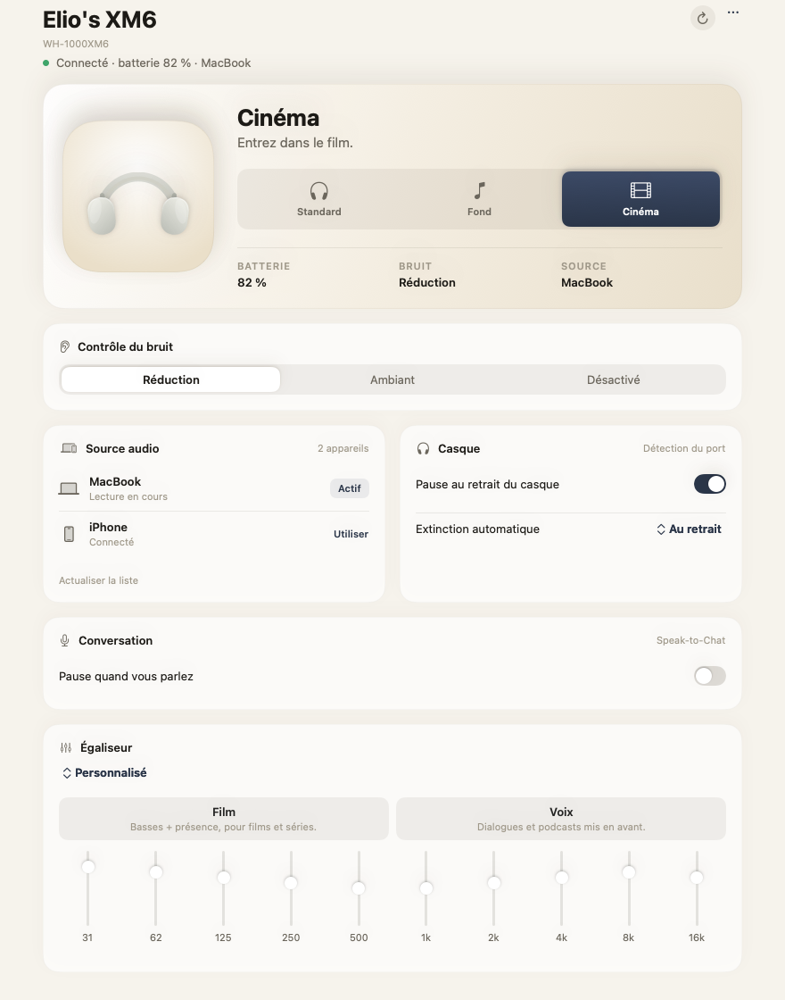
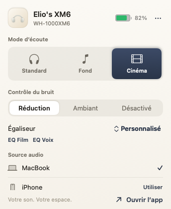
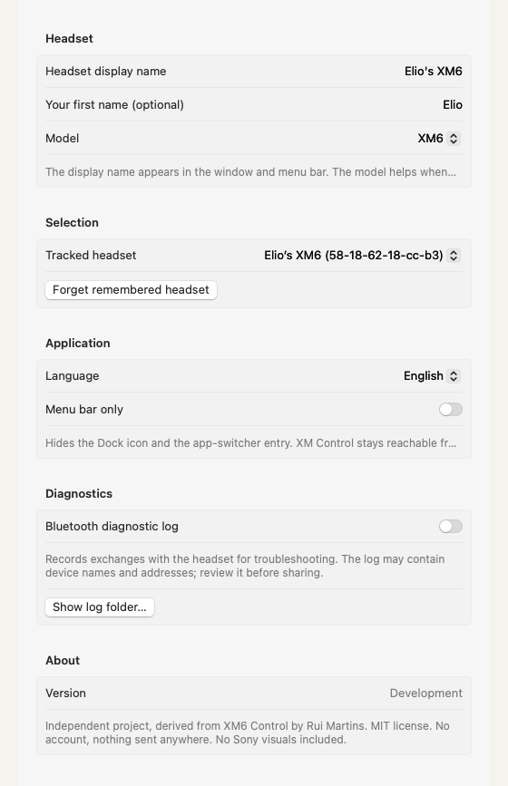

# XM Control

I made this for myself because I wanted my Sony headset to just work from my Mac's menu bar — and I figured it might help a few of you too.

It works with **Sony WH-1000XM4 / XM5 / XM6**, with **Standard / Background Music / Cinema** one click away.

### ⬇️ Download

**[Download XM-Control-1.0.dmg](https://github.com/elio-bernardinello/xm-control/releases/download/v1.0/XM-Control-1.0.dmg)** (1.2 MB, macOS 13+)

No account, no server, everything stays on your Mac.




*Real app screens with sample data. Dark mode included ([preview](screenshots/real-main-dark.png)). No Sony photos in the app.*

I vibe-coded this on top of an open-source project — I don't remember the exact name, sorry — credit to the original author is kept and the MIT license with it. Feel free to fork it and make your own version, honestly that's the point.

## How I actually use it

1. **Cinema mode for movies on my laptop.** One click in the menu bar (or `⌘⌥3`). The app tells you if the headset really confirmed it or not, so no more guessing whether it worked.
2. **When my phone steals the connection.** You can see which device is playing, pause the other one, hit **Use** on the Mac and you're back. No more digging through Bluetooth settings.
3. **EQs without opening another app.** Sony presets plus the 10-band sliders, and two one-tap buttons I added: **Film** (full but clear, for shows) and **Voice** (cuts the rumble, pushes dialogue — great for podcasts and calls).

## Install — no tech skills needed (2 minutes)

1. Download the **[DMG above](https://github.com/elio-bernardinello/xm-control/releases/download/v1.0/XM-Control-1.0.dmg)** and open it.
2. Drag **XM Control** into **Applications**, then open it from there.
3. **First launch, macOS will complain** — totally normal, the app isn't notarized by Apple. Don't double-click it: **right-click (or Ctrl-click) XM Control → Open → Open**. You only do this once.
4. When macOS asks, **allow Bluetooth access** — otherwise the app can't talk to your headset.
5. Make sure your headset is paired in **System Settings → Bluetooth** and turned on.
6. If it's already connected for sound, the app joins it by itself within seconds. Otherwise hit **Connect** — it asks macOS to bring the Bluetooth link up first.
7. Open **XM Control → Settings…** (`⌘,`) and set your headset name (mine says `Elio's XM6` — put whatever you like, `My XM6`, `XM4`…) and your model. Done.

If it says the headset isn't responding: turn the headset off and on, check it's connected in System Settings, then hit Connect again. Forgetting + re-pairing is a last resort.

> Heads-up: the app itself speaks French for now (I'm French 🙂). This guide is in English, the [French README is here](README.fr.md). English UI help is very welcome.

## Make it yours

In **Settings…** (`⌘,`):

- **Headset display name** — free text shown everywhere (`My XM6`, `Marie's XM6`…). Empty = `My headset`.
- **First name (optional)** — stored on your Mac only, never sent anywhere.
- **Model** — `Automatic`, `XM4`, `XM5`, `XM6`. Helps when several XM headsets are paired.
- **Tracked headset** — pick from your paired XM devices, or leave Automatic. A remembered headset stays remembered even after a rename.

It recognizes `WH-1000XM4` / `XM5` / `XM6` and any custom name with `XM4`/`XM5`/`XM6` in it. One match → picked. Several → it asks you instead of guessing.

Shortcuts when the app is active and connected: `⌘⌥1` Standard, `⌘⌥2` Background Music, `⌘⌥3` Cinema.

## Good to know

- Bluetooth control and Mac audio output are two different things: music playing doesn't mean the control session is up. The app only treats a setting as done when the headset confirms it.
- `Loading…` then `not reported` just means your model didn't report that feature (common on XM4/XM5 for a few items) — not a bug.
- The log is off by default (`~/Library/Application Support/XM Control/protocol.log`). It can contain device names, so check before sharing.
- No Sony pictures inside — the headset drawing is a built-in illustration. You can drop your own local `headphones.png` in Application Support if you want (see ImageCredits.txt). Please don't publish Sony visuals without rights.
- Independent project, not affiliated with or endorsed by Sony or Apple.

## For developers

```sh
git clone https://github.com/elio-bernardinello/xm-control.git
cd xm-control
swift test          # 47 tests, mocked transport, no headset needed
./Scripts/build_app.sh
open ".build/XM Control.app"
```

macOS 13+, Swift 6. Bundle id `app.xmcontrol`. Signed with your own cert if present, else ad-hoc (`XM_SIGN_IDENTITY` to force). Not notarized.

[Architecture](Documentation/Architecture.md) · [Verification](Documentation/Verification.md) — French for now, translations welcome.

## Credits

MIT + original attribution to [Rui Martins (XM6 Control)](https://github.com/ruimartins23/xm6-control) kept in [LICENSE](LICENSE). Protocol references: [Gadgetbridge](https://codeberg.org/Freeyourgadget/Gadgetbridge), [SonyHeadphonesClient](https://github.com/Plutoberth/SonyHeadphonesClient) and [mos9527's fork](https://github.com/mos9527/SonyHeadphonesClient). No guarantee on every command.
