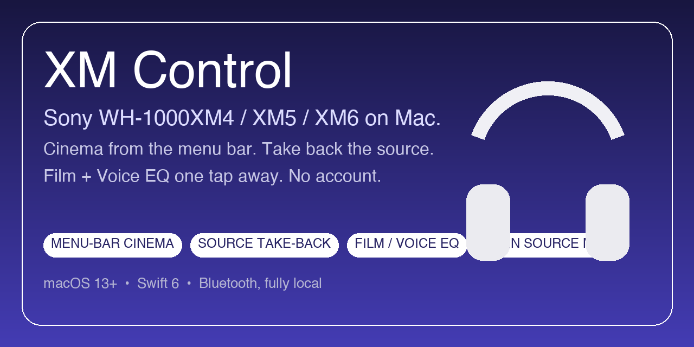
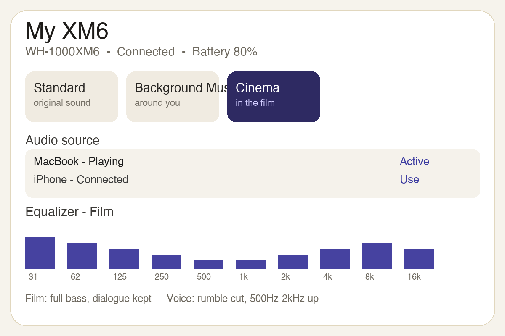
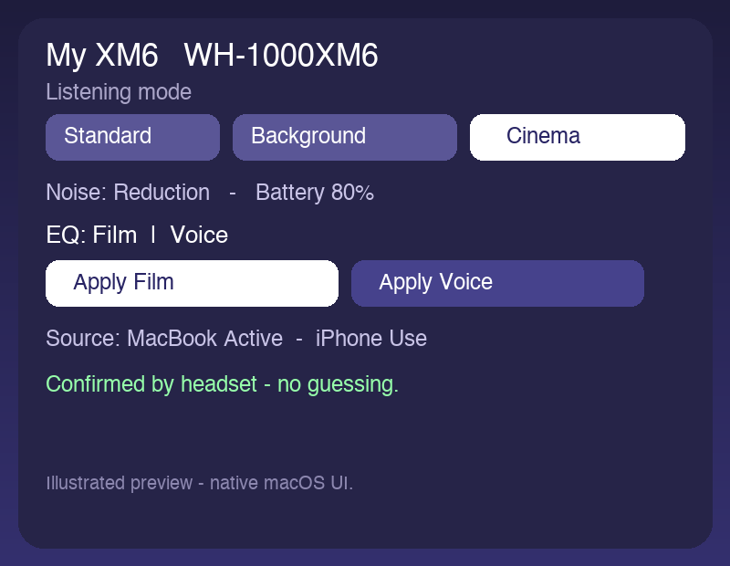

# XM Control



A native macOS app for **Sony WH-1000XM4 / XM5 / XM6**, with **Standard / Background Music / Cinema** right from the menu bar.



*Illustrated previews — native macOS UI, no Sony photos included.*

Forked from [XM6 Control by Rui Martins](https://github.com/ruimartins23/xm6-control). Historic Swift module names (`SonyHeadphonesKit`, `XM6Control`) are kept to limit churn; only the visible product is generic: **XM Control**.

> Note: the app UI is currently in French. The README below is in English — French version here: [README.fr.md](README.fr.md). English UI contributions welcome.

## Install in 2 minutes

Requirements: macOS 13+, Apple tools with **Swift 6** (`swift --version`).

```sh
git clone https://github.com/elio-bernardinello/xm-control.git
cd xm-control
swift test
./Scripts/build_app.sh
open ".build/XM Control.app"
```

1. Pair your headset in **System Settings → Bluetooth** and turn it on.
2. On first launch, allow Bluetooth access when macOS asks.
3. If your headset is already connected for audio, the app joins it automatically within seconds. Otherwise hit **Connect**.
4. Open **XM Control → Settings…** (`⌘,`) to set your display name, e.g. `Marie's XM6`, and pick your model.

No account, no server, everything stays on your Mac. Bundle id: `app.xmcontrol`. The local build is signed with your own `Apple Development` cert if present, else `XMDev`, else ad-hoc (`XM_SIGN_IDENTITY` to force one). It is not notarized for Apple distribution.

## Personalization

In **XM Control → Settings…** (`⌘,`):

- **Headset display name**: free text, e.g. `Marie's XM6`, `My XM6`, `XM4`. Shown in the window, menu and announcements. Empty by default (`My headset`).
- **Your first name (optional)**: stored locally only, never sent anywhere.
- **Model**: `Automatic`, `XM4`, `XM5`, `XM6`. Helps when several XM headsets are paired.
- **Tracked headset**: list of paired XM devices + `Automatic`. The remembered address wins even after a rename. `Forget remembered headset` restarts detection.

Auto-detection recognizes:
`WH-1000XM4`, `WH-1000XM5`, `WH-1000XM6` and any custom name containing `XM4` / `XM5` / `XM6` (e.g. `My XM6`). Single candidate → picked. Several → explicit choice required, nothing is guessed.

## Usage

- Pair in **System Settings → Bluetooth**, turn the headset on, allow Bluetooth on first launch.
- The app tries the remembered headset or the single XM candidate. If already connected for audio, the Sony session is joined automatically (no click) within seconds and on foreground return.
- If paired but not connected, **Connect** first asks macOS to bring the Bluetooth link up, then opens the Sony session.
- Settings appear once the session is up. Menu bar: listening modes, battery, noise control. Main window: full settings.
- **Settings…** holds menu-bar-only mode and diagnostics. The mini panel is a small headset remote, no audio playback controls.
- Shortcuts `⌘⌥1`, `⌘⌥2`, `⌘⌥3`: Standard, Background Music, Cinema (app active + connected).

Command Bluetooth is separate from macOS audio output: audible music does not guarantee the control session is up. A selection must be confirmed by headset replies; on failure, check the link and retry.

## 2-minute how-it-works

1. **Click-free connect.** Turn on the paired headset: if connected for macOS audio, the app joins alone in seconds (same on foreground return). Otherwise **Connect** brings Bluetooth up first, then opens the Sony session.
2. **Cinema mode for a movie on your Mac.** Menu bar → **Cinema** (or `⌘⌥3`). The UI shows `requested` / `confirmed by headset` / `not confirmed`: only confirmed counts for sound. No confirmation → check the link and retry.
3. **Phone stole the connection?** **Audio source** card: current playback is marked `Active`. Pause the other device, hit **Use** on the Mac. If the iPhone instantly resumes, pause it again and retry — the app tells you.
4. **EQs at hand.** Sony presets + 10-band sliders + 2 shortcuts:
   - **Film**: full bass, dialogue kept — for movies/series.
   - **Voice**: rumble cut, 500 Hz–2 kHz pushed — for dialogue, podcasts, calls.
   One click applies the curve (headset switches to `Custom`). Sliders stay editable after.
5. **Yours.** Settings: display name, model, tracked headset. Nothing ever leaves your Mac.

FAQ: `Loading…` then `not reported` = the headset didn't report it (normal on XM4/XM5 for some features). `Headset not responding` = link lost: turn on, reconnect macOS audio, then **Connect**. Logging off by default.

## Build

```sh
swift test
./Scripts/build_app.sh        # release by default
./Scripts/build_app.sh debug
```

Produces a standalone `.build/XM Control.app` in a temp dir, verifies it, then replaces only its own build product. Never launches or replaces an installed app.

[Architecture](Documentation/Architecture.md) · [Verification](Documentation/Verification.md) — docs currently in French, translation welcome.

## Capabilities and limits (XM4 / XM5 / XM6)

Noise control, ambient level, listening modes + room size, EQ, battery, multipoint, Speak-to-Chat, wear detection, auto power off: each is shown only if the headset really reports it. `Loading…` then `not reported` means the model/firmware didn't confirm it, not a display bug.

- Shared protocol (Sony "v2" transport used by XM5/XM6) implemented; XM4 works as a compatible subset.
- BGM / Cinema and some fine settings were first validated on XM6: on XM4/XM5 they may stay unavailable depending on headset replies.
- Automated tests simulate protocol and sessions; they prove neither acoustic effect nor real Bluetooth reliability. Validate each generation with its headset. No CPU / battery / latency claims without measurement.

## Troubleshooting

No response → check System Settings connection, retry from its card. Disconnect/reconnect in macOS if needed. Forget + re-pair is a last resort.

Optional log, off by default: `~/Library/Application Support/XM Control/protocol.log`. May contain names/addresses: review before sharing. Settings opens its folder. A connection must never silently change your headset settings.

## Origin, images, license

Code: [MIT + original attribution to Rui Martins](LICENSE). Protocol refs: [Gadgetbridge](https://codeberg.org/Freeyourgadget/Gadgetbridge), [SonyHeadphonesClient](https://github.com/Plutoberth/SonyHeadphonesClient) and [mos9527's fork](https://github.com/mos9527/SonyHeadphonesClient). No guarantee on every command.

**No Sony image included.** UI uses a vector illustration. See [ImageCredits.txt](Sources/XM6Control/Resources/ImageCredits.txt) to add your own local `headphones.png` (not redistributed). Never publish Sony visuals without rights.

XM Control is independent from Sony and Apple, no affiliation or endorsement. Brands belong to their owners.
